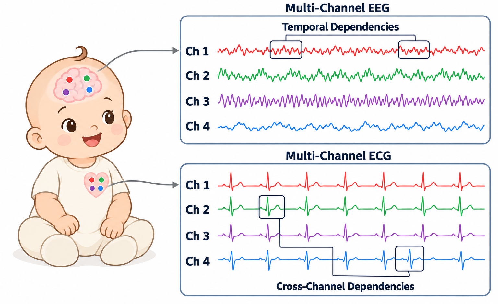
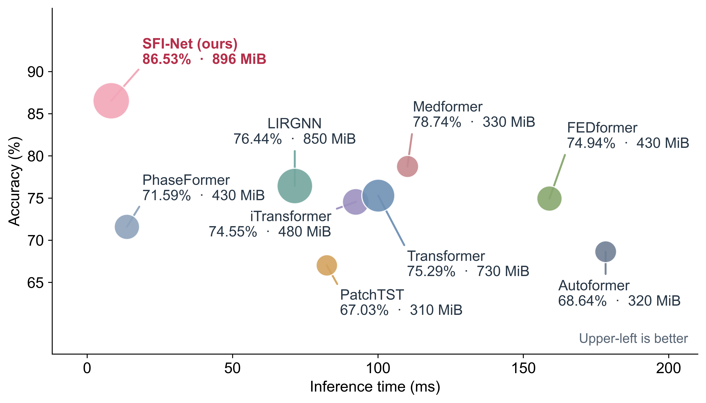
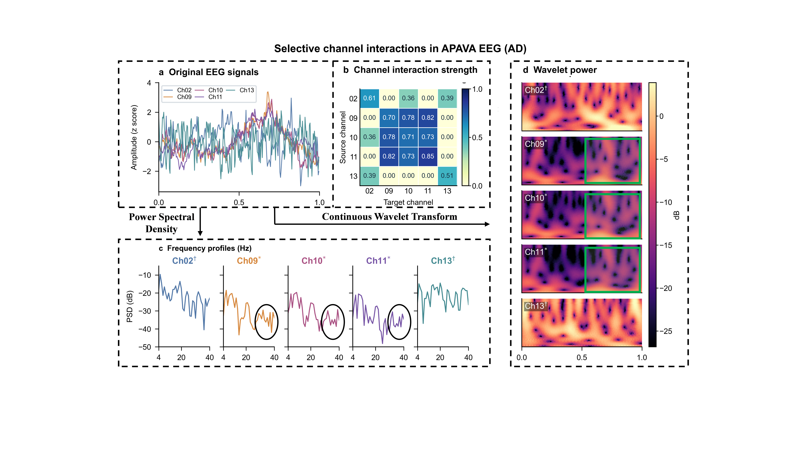
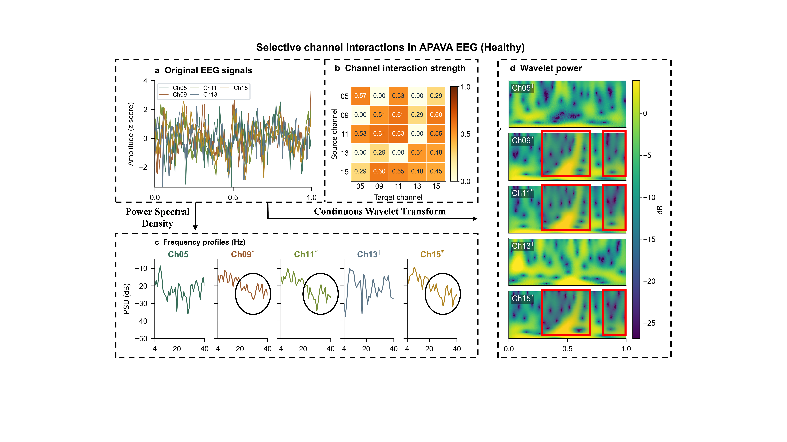
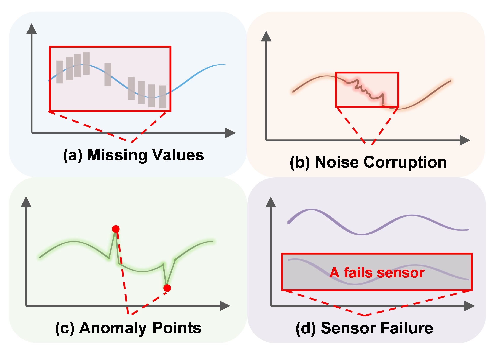

<div align="center">

# SFI-Net: A Spatiotemporal Flexible Interaction Network for Medical Time-Series Classification

**Selective cross-channel communication across time — without forcing every channel pair to interact.**

[](#scope-of-this-release)
[](#method-at-a-glance)
[](#data-preparation)


<sub>Conceptual overview: channel-independent (CI), channel-dependent (CD), and SFI interactions.</sub>

<p align="center">
  
</p>
<p align="center"><sub>Medical signal overview: multichannel EEG and ECG sequences with within-channel temporal structure and cross-channel dependencies.</sub></p>

</div>


The implementation keeps the temporal encoder channel-independent and introduces cross-channel interaction in the channel–patch graph stage. The graph uses cosine similarity with Top-*k* neighbors; Low/Mid/High spectral responses are softly assigned and fused with node-wise gates. See [`models/Ours.py`](models/Ours.py) for the implementation and [`experiments/ours_trainer.py`](experiments/ours_trainer.py) for training and evaluation.


<p align="center">
  
</p>
<p align="center"><sub>APAVA efficiency comparison from the project figure assets. It is included as a visual result summary, not generated by the bundled training runner.</sub></p>

## Visual examples

Representative channel-interaction and time–frequency visualizations from APAVA are shown below. These are **illustrative examples**, not outputs regenerated by the minimal runner in this folder.

<table>
  <tr>
    <td align="center" width="50%"><br><sub>APAVA — AD example</sub></td>
    <td align="center" width="50%"><br><sub>APAVA — healthy example</sub></td>
  </tr>
</table>

<p align="center">
  
</p>
<p align="center"><sub>Robustness-setting illustration from the broader project materials; robustness experiment code is intentionally outside this release.</sub></p>

## Setup

Python 3.10 is recommended. Install a PyTorch build compatible with your CUDA setup if using a GPU, then install the remaining pinned dependencies:

```bash
pip install -r requirements.txt
```

The runner uses CUDA by default when available. To explicitly allow CPU execution, add `--allow-cpu`.


## Run the main experiments

From this directory, run the default five-seed APAVA experiment:

```bash
python run_ours.py --dataset APAVA
```

Run ADFTD, or both supported datasets:

```bash
python run_ours.py --dataset ADFTD
python run_ours.py --dataset all
```

To use data or output locations elsewhere:

```bash
python run_ours.py \
  --dataset APAVA \
  --apava-root /path/to/dataset-parent \
  --output-root ./outputs \
  --seeds 42 43 44 45 46
```

The output directory contains run arguments, per-seed checkpoints and metrics, split manifests, aggregate metrics, and diagnostic arrays. Dataset-specific default training settings and the subject-level split logic are kept in the source so the run configuration is inspectable.

